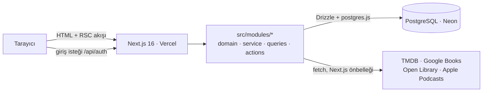

# Mimari

Claquette tek bir Next.js uygulaması: arayüz, sunucu mantığı ve API aynı kod tabanında, aynı deploy ile çalışıyor. İçeride **modüler monolit** olarak bölünmüş durumda. Her özellik kendi klasöründe, katmanları belli; ileride bir parçayı ayrı servise taşımak gerekirse sınırlar hazır.



## 1. Teknoloji seçimleri

| Katman | Seçim | Neden | Değerlendirilen alternatifler |
| --- | --- | --- | --- |
| Uygulama çatısı | **Next.js 16** (App Router), React 19, TypeScript | Arayüz ve sunucu tek projede. Server Components veriyi sunucuda okuyor, Server Actions ayrı bir REST katmanı yazmadan form gönderimlerini karşılıyor. Vercel'de sıfır ayarla çalışıyor. | Ayrı SPA + NestJS/Express API: iki deploy, iki kod tabanı. Render'ın ücretsiz katmanında API 15 dakika boşta kalınca uykuya geçiyor, ilk istek yavaş. |
| Veritabanı | **PostgreSQL** | Veri ilişkisel (grup → üye → ortak liste → tur → öge; kullanıcı → kişisel liste → öge). Kurala özgü ayarlar için JSONB, liste alanları için dizi tipleri var. Neon, Supabase, Railway gibi her yerde çalışıyor. | MongoDB: ilişkiler ve bütünlük kısıtları zayıf. SQLite/Turso: iyi bir seçenek ama Postgres'in JSONB ve kısmi index'leri burada işe yarıyor. |
| ORM | **Drizzle ORM** + drizzle-kit | TypeScript'te tanımlanan şema hem tipleri hem SQL migration'larını üretiyor. Hafif, ayrı bir motor süreci yok; serverless'ta hızlı açılıyor. SQL'e yakın olduğu için ne çalıştığı belli. | Prisma: olgun ama daha ağır; şema ayrı bir dilde. |
| Kimlik doğrulama | **Better Auth** (kullanıcı adı + şifre) | Tablolar kendi veritabanımızda, dış servise bağımlılık yok. Şifre hash'leme, oturum yönetimi, CSRF koruması ve giriş denemesi limiti hazır. İleride tek satırla Google ile giriş, passkey ya da şifre sıfırlama eklenebiliyor. Auth.js ekibi de 2025'te Better Auth'a katıldı. | Clerk ya da Supabase Auth: hazır ama dış servise ve kotalarına bağımlılık. Elle yazılmış oturum: küçük ama güvenlik yükü bize kalıyor. |
| Arayüz | Tailwind CSS v4, projede duran shadcn tarzı bileşenler | Bileşenler kütüphane değil kodun parçası, istediğin gibi değiştirebilirsin. Açık/koyu tema CSS değişkenleriyle. | Hazır bileşen kütüphaneleri: özelleştirmesi zor, paket boyutu büyük. |
| Doğrulama | **Zod 4** | Form girdileri, öneri kurallarının JSON ayarları ve ortam değişkenleri tek araçla doğrulanıyor. | — |
| Test | **Vitest** | Saf iş mantığı (tur hesabı, kurallar, yetki) veritabanı olmadan test ediliyor. | Jest: daha yavaş, ESM ayarı zahmetli. |
| Barındırma | **Vercel Hobby + Neon Free** | İkisi de kredi kartı istemiyor. Neon boşta 5 dakikada uyuyor ve yarım saniyenin altında uyanıyor; Supabase gibi bir hafta kullanılmayınca projeyi dondurmuyor. Bu, aylık ya da çeyreklik listelerde önemli. | Supabase (alternatif olarak destekleniyor), Render (ücretsiz Postgres'in süresi doluyor), Netlify. |

## 2. Kod düzeni ve katmanlar

```text
src/app/                rotalar: sayfa bileşenleri ince, veriyi modüllerden ister
src/modules/<özellik>/
  domain/ | domain.ts   saf mantık: veritabanı ya da Next.js bilmez, birim testli
  service.ts            yazma işlemleri (transaction, iş kuralları, olay kaydı)
  queries.ts            sayfaların ihtiyaç duyduğu okumalar (yetki kontrolüyle)
  actions.ts            Server Actions: girdiyi Zod ile doğrula → yetki → service → refresh/redirect
  components/           o özelliğe ait arayüz
src/db/schema/          tek gerçek kaynak; drizzle/ altındaki SQL bundan üretilir
src/components/ui/      ortak bileşenler
```

Bir isteğin yolu (örnek: öneri yapmak):

1. `suggest-form.tsx` (Client Component) formu `suggestEntryAction`'a gönderir.
2. Action `requireUser()` ile oturumu doğrular, girdiyi Zod ile şekillendirir.
3. `entries/service.ts › suggestEntry` listeye erişimi kontrol eder, eksik turları üretir (`syncRounds`), listenin **kuralına** "bu kişi şu an kime, kaç öneri yapabilir?" diye sorar, medya ögesini katalogdan bulur ya da API'den içe aktarır, ögeyi ve olay kaydını tek transaction'da yazar.
4. Action `redirect()` ile liste sayfasına döner; sayfa güncel veriyle sunucuda yeniden render edilir.

Yetki her zaman verinin yanında kontrol ediliyor: her sayfa ve her Server Action `requireUser()` + grup üyeliği kontrolünden geçiyor. `proxy.ts` sadece oturum çerezi olmayanları giriş sayfasına yönlendiren hızlı bir ön kontrol. Tek istisna herkese açık kişisel listeler (§6).

## 3. Ortak liste motoru

Arayüzde "ortak liste" denen şeyin kodda ve veritabanında adı **challenge**. Bir ortak listenin davranışını üç bağımsız veri belirliyor: **sıklık**, **seçim kuralı** ve **durum akışı**. Yeni bir liste türü genellikle bu üçünün yeni bir kombinasyonu; kod değişikliği gerekmiyor.

### 3.1 Sıklık (cadence)

`cadence_unit` (`day | week | month | year | none`) × `cadence_interval`:

| Ön ayar | Değer |
| --- | --- |
| Haftalık / İki haftada bir | `week × 1` / `week × 2` |
| Aylık / Çeyreklik | `month × 1` / `month × 3` |
| Yıllık | `year × 1` |
| Özel | ör. `day × 10` → "10 günde bir" |
| Süresiz | `none`: turları katılımcılar "Sonraki tura geç" ile ilerletir |

Periyotlar başlangıç tarihine sabitlenir: k. tur = başlangıç + k × aralık. Hesap her zaman başlangıçtan yapıldığı için ay sonları kaymaz (31 Ocak → 28 Şubat → 31 Mart). "Bugün" grubun saat diliminde (varsayılan `Europe/Istanbul`) hesaplanır ve tarih matematiği saatsiz ISO tarihlerle yapılır; yaz saati geçişleri sınırları kaydırmaz. Kodu ve testleri: `src/modules/challenges/domain/cadence.ts`.

### 3.2 Turlar: cron yerine tembel üretim

Turlar (`rounds`) veritabanında tutulur ama zamanlayıcıyla üretilmez. Biri listeyi, grubu ya da ana sayfayı açtığında `syncRounds()` eksik periyotları bugüne kadar ekler ve her yeni tur için kuralın atamalarını (`round_assignments`, "kim kime önerecek") kaydeder.

- **Cron gerekmiyor.** Ücretsiz katmanda zamanlanmış görev sınırlı; burada hiç ihtiyaç yok.
- **Tekrar çalıştırmak güvenli.** `(challenge_id, index)` benzersiz index'i ve `ON CONFLICT DO NOTHING` sayesinde aynı anda iki istek gelse de tur bir kez oluşur.
- **Geçmiş bozulmaz.** Atamalar tur oluşurken saklanır; sonradan katılan biri eski turları değiştirmez, sıradaki turdan itibaren rotasyona girer.
- **Planlanan turlar önceden oluşabilir** (§3.5). Turlar her zaman 0'dan başlayıp boşluksuz ilerler: ileri bir tur gerektiğinde aradaki turlar da oluşturulur. Bu yüzden "en yüksek index" eksik turları bulmaya yetiyor; "şu anki tur" ise tarihe bakılarak bulunuyor (`getCurrentRound`), en son satıra değil.

### 3.3 Seçim kuralları (Strategy deseni)

Her kural aynı arayüzü uygulayan saf bir nesne (`src/modules/challenges/domain/strategies/types.ts`):

```ts
interface ChallengeStrategy<C> {
  key: string;                         // veritabanında saklanan anahtar
  label: string;
  configSchema: z.ZodType<C>;          // challenges.strategy_config (JSONB) bununla doğrulanır
  configFields: ConfigField[];         // formdaki ayarlar bu tanımdan otomatik çizilir
  planRound(ctx): AssignmentPlan[];    // tur başlarken: kim kime önerecek?
  suggestionOptions(ctx): SuggestionOptions; // şu an kime, kaç öneri, hangi durumda başlar?
  poolRules?(config): PoolRules;       // havuz kullanan kurallar için
  planning?(config): PlanningRules;    // turları elle doldurmaya izin veren kurallar için (§3.5)
  describeConfig(config): string;      // rozet metni
}
```

Hazır kurallar:

| Kural | Davranış | Ayarlar |
| --- | --- | --- |
| **Birlikte belirliyoruz** (`joint`) | Sıra yok. Ekleyen kişi seçer: *Anlaştık, plana ekle* (öge seçilen tura girer) ya da *Öneri olarak ekle* (öneriler bölümünde bekler). Turlar önceden ve geriye dönük doldurulur. Formdaki varsayılan kural. | tur başına öge sayısı (0 = sınırsız) |
| **Sırayla öneri** (`rotation`) | *Karşılıklı / zincir:* herkes sıradaki kişiye önerir, halka her tur kayar; n kişide n−1 turda herkes herkese önermiş olur, iki kişide karşılıklı takastır. *Tek seçici:* her tur sıradaki kişi tüm grup için seçer. | mod, tur başına öneri sayısı, kabul onayı |
| **Serbest öneri** (`open`) | Herkes istediği kişiye ya da tüm gruba önerir. | tur başına limit, gruba öneri, kabul onayı |
| **Ortak havuz** (`pool`) | Öneriler havuza aday olarak girer. Her tur adaylardan seçim yapılır. | seçim yöntemi (oy / kura / elle), tur başına seçim, otomatik seçim, kişi başı aday limiti |

Yeni bir kural ("her ay temalı kura", "eleme turnuvası"…) için `ChallengeStrategy` uygulayan bir dosya yazıp `STRATEGIES` listesine eklemek yeterli. Veritabanı sadece anahtarı ve JSON ayarları sakladığı için migration gerekmez; formdaki ayar alanları `configFields`'tan kendiliğinden çizilir. Kurallar saf olduğu için veritabanı olmadan test ediliyor (`strategies.test.ts`).

### 3.4 Ortak havuz ve oylama

Havuzdaki aday, turu olmayan (`round_id IS NULL`) ve "Karar bekliyor" kategorisindeki bir ögedir. Seçim (`challenges/pool.ts`) tur satırını kilitler (`SELECT … FOR UPDATE`, aynı anda iki seçim yapılmasın diye), boş yer sayısını hesaplar, `pickFromPool` ile adayları seçer (en çok oy; eşitlikte kura) ve seçilenleri tura alıp ilk "Sürüyor" adımına taşır. "Otomatik seçim" açıksa bu, yeni tur oluştuğu anda yapılır.

### 3.5 Planlama

`planning()` döndüren kurallarda (bugün yalnızca *Birlikte belirliyoruz*) katılımcılar ögeyi istedikleri tura koyar. Saf mantık `challenges/domain/plan.ts`'te, veritabanı tarafı `challenges/planning.ts`'te.

- **Hangi turlar görünür?** Takvimli listede tur, sıklığın bir periyodudur; henüz satırı olmayan gelecek turlar da hesaplanıp gösterilir ve ilk doldurulduklarında oluşturulur. Başı sonu belli kısa bir liste (≤ 24 tur, ör. 2027'nin dört çeyreği) bütün olarak görünür. Süresiz takvimli listede şu anki turdan (ya da en ileri dolu turdan) sonra birkaç boş tur görünür, seçim kutusunda 24 tur daha sunulur. Plan ilerledikçe bu pencere de ilerler, yani sabit bir sınır yok. Takvimsiz (süresiz, elle ilerletilen) listede yalnızca başlamış turlar seçilebilir.
- **Geçmiş ve gelecek:** Tura eklenen öge ilk "Sürüyor" ("Kabul Edildi") adımına girer. Tur geçmişse form kimin bitirdiğini sorar: "Hepimiz bitirdik" (varsayılan), "Sadece ben bitirdim" ya da "Henüz bitmedi". Seçilenler için kişisel ilerleme turun son günüyle "bitirdi" olarak yazılır; herkes bitirmişse öge doğrudan "Tamamlandı" olur, değilse "Zamanı geçti" görünür (§4.1). Liste başlangıç tarihi geçmişte olabilir; geçmiş turlar sonradan doldurulur.
- **Tur kapasitesi:** "Tur başına öge" sınırı, tur satırı kilitlenerek (`SELECT … FOR UPDATE`) ve elenmemiş ögeler sayılarak uygulanır; aynı anda iki kişi aynı tura ekleyemez.
- **Birden çok öge:** Tek seferde plana eklenen ögeler seçilen turdan başlayarak boş yeri olan turlara sırayla yerleşir (`suggestEntries`: tur dolunca bir sonrakine geçer, en çok 240 tur ileri). Tur başına sınır yoksa hepsi seçilen tura girer. Örneğin "Ocak–Mart"tan başlayan üç kitap ilk üç boş çeyreğe dağılır.
- **Öneriler:** Turu olmayan öge öneridir; diğerlerine sorulmuş bir sorudur. Yazan kişi dışında bir katılımcı bir tur seçerek kabul eder (`canAcceptSuggestion`); grup yöneticisi de kendi önerisini kabul edemez, yalnızca listede tek kalan kişi kendi önerisini yerleştirebilir. Yazan kişi geri çekebilir, diğerleri reddedebilir. "Önerilere geri al" ile plandan çıkarılan öge de yeniden öneri olur ve diğerlerinin onayını bekler.
- **Durum değişiklikleri:** Planlı listede bir öneri "Kabul Edildi" yapılarak değil tura yerleştirilerek kabul edilir; turdaki öge de "Önerildi"ye çekilerek değil "Önerilere geri al" ile çıkarılır (`isPlanStateChangeAllowed`, hem arayüzde hem sunucuda). Öneri, herkes bitirse bile tura yerleşene kadar otomatik tamamlanmaz.
- **Taşıma:** Öge başka bir tura taşınabilir; taşımak ögenin tamamlanıp tamamlanmadığını değiştirmez. Henüz tamamlanmamış bir öge geçmiş bir tura taşınırken yine kimin bitirdiği sorulur.
- **Olay kaydı:** `entry.planned` (tura eklendi / öneri kabul edildi), `entry.moved`, `entry.unplanned`; hepsi turun adını ("Kasım 2026", "Ocak–Mart 2027") anlık kopya olarak saklar.

### 3.6 Ana sayfa ve kartlar

En üstte **Bana atananlar** durur (`home/assigned.ts`, saf ve birim testli): izleyenin ait olduğu, bir turdaki ve henüz bitirmediği ögeler. Kartlardaki takip bilgisini kullanır (§4.1), yani liste sayfalarıyla aynı sonucu verir. Turun zamanına göre üç başlık var: *Zamanı geçenler* (en eski önce, "12 gün önce bitti"), *Devam edenler* (en yakın biten önce, "3 gün kaldı"; süresiz listenin açık turu en sonda), *Sıradakiler* (her listenin yalnızca bir sonraki turu, "5 gün sonra başlıyor"; bir yıl önceden yapılan plan sayfayı doldurmasın diye).

`challenges/summaries.ts` her ortak liste için bugünü hesaplar: şu anki tur (ad, kalan gün, ögeler ve izleyenin kendi durumu), planlı listelerde sıradaki iki tur, başlamamış ya da bitmiş listeler için tek satırlık durum. Az sayıda gruplanmış sorguyla çalışır; ana sayfa ve grup sayfası aynı kartı kullanır. Kişisel listeler ana sayfada yer almaz; "Listelerim" ayrı bir bölüm.

## 4. Durum akışı ve ilerleme

İki ayrı katman var:

1. **Grup düzeyinde durum** (`entries.state_id` → `workflow_states`): ögenin ortak yolculuğu. Adımlar veri: adı, rengi ve sırası grup tarafından belirlenir.
2. **Kişisel ilerleme** (`entry_progress`): her üyenin kendi durumu (`planned / in_progress / completed / dropped`) ve 1–10 puanı.

Motor adım adlarına hiç bakmaz, yalnızca adımın **kategorisini** bilir: `pending` (karar bekliyor), `active` (sürüyor), `done` (tamamlandı), `dropped` (elendi). Bu yüzden akışa "Okunuyor" ya da "Ertelendi" eklemek hiçbir kodu bozmaz:

- Yeni öneri, kurala göre ilk `pending` ya da ilk `active` adımında başlar.
- Havuzdan seçilen öge ilk `active` adımına geçer.
- Ögenin ait olduğu herkes bitirince öge ilk `done` adımına geçer (otomatik tamamlama, §4.1). Planlı listede henüz tura yerleşmemiş öneriler bunun dışında.
- Planlı listede tura eklenen öge ilk `active` adımında başlar; geçmiş bir turda kimin bitirdiği sorulur (§3.5).
- Atama doluluğu, tur kapasitesi ve limitler `dropped` dışındaki ögelerle hesaplanır.

### 4.1 Takip

Zaman çerçeveyi verir, tamamlanmayı kişiler belirler. Kurallar saf ve birim testli (`entries/tracking.ts`):

- **Ait olduğu kişiler:** ögenin alıcısı varsa o kişi, yoksa listenin aktif katılımcıları (`assigneesOf`).
- **Tamamlanma:** hepsi "bitirdi" ya da "yarım bıraktı" dediğinde ve en az biri bitirdiğinde öge ilk `done` adımına geçer. Yarım bırakan beklenmez; herkes yarım bıraktıysa karar gruba kalır.
- **Yeniden açılma:** ait olduğu kişilerden biri "bitirdi" işaretini geri alırsa `done` öge ilk `active` adımına döner. Başka birinin durum değişikliği, elle verilmiş bir "Tamamlandı" kararını bozmaz (`stateAfterProgress`).
- **Zamanı geçti:** turu bitmiş (takvimli listede bitiş günü geçmiş, süresiz listede tur kapatılmış) ama ait olduğu kişilerden biri henüz bitirmemiş `active` öge. Saklanmaz, her okumada tarihten ve ilerlemeden hesaplanır (`trackEntry`); son kişi bitirdiği an kendiliğinden kalkar, cron gerekmez.
- **Görünüm:** kartta "Zamanı geçti" rozeti, diğerlerinin durumu ve izleyenin tek dokunuşluk "İzledim/Okudum" düğmesi (bildirimde "Geri al"). Planda bitirmeyeni olan geçmiş turlar katlanmaz.
- Takip yalnızca bir tura girmiş ve grubun üstlendiği ögeler içindir: öneriler, havuz adayları, cevap bekleyen kişisel öneriler ve elenenler takip edilmez.

Yetki kuralı (`canChangeState`, birim testli): kişiye özel ve hâlâ karar bekleyen bir öneriyi yalnızca alıcısı yanıtlar; öneren yalnızca geri çekebilir. Diğer durum değişiklikleri katılımcılara açık; grup yöneticileri her şeyi değiştirebilir.

**Silme:** Yanlışlıkla eklenen bir öge, ögenin sayfasındaki "Listeden sil" ile (sayfanın içinde onay sorularak) silinir; notları, puanları, oyları ve kendi olay geçmişi de gider. Yalnızca ekleyen kişi, listeyi kuran ve grup yöneticileri silebilir (`canDeleteEntry`, birim testli). Grup akışında başlığın kopyasıyla bir `entry.deleted` olayı kalır. Konuşulup vazgeçilen bir öge için silme değil "Reddedildi" (elendi) adımı kullanılır; böylece iz kalır.

## 5. Medya kaynakları ve elle ekleme

```ts
interface MediaProvider {
  id: string; label: string; mediaTypes: string[];
  isConfigured(): boolean;                     // API anahtarı yoksa sağlayıcı atlanır
  search(query, mediaType): Promise<MediaSearchResult[]>;
  getDetails(externalId, mediaType): Promise<MediaDetails | null>;
}
```

| Tür | Sağlayıcı | Anahtar |
| --- | --- | --- |
| Film, dizi | TMDB (Türkçe başlık ve özet; özet yoksa İngilizcesi) | `TMDB_API_KEY` (v3 anahtarı ya da v4 token, ikisi de olur). Ücretsiz katman: günlük kota yok, saniyede yaklaşık 40 istek üst sınır |
| Kitap | Google Books + Open Library (paralel) | Google için önerilir (proje başına günlük kota). Open Library anahtarsız: saniyede 1 istek, uygulamayı tanıtan User-Agent ile 3 |
| Podcast | Apple Podcasts (iTunes Search API) | yok (dakikada yaklaşık 20 istek) |
| Oyun, diğer | yok: elle ekleme | — |

- Arama tarayıcıdan doğrudan değil `/api/media/search` üzerinden yapılır; anahtarlar sunucuda kalır, istek oturum gerektirir.
- Sağlayıcılar paralel sorgulanır (`Promise.allSettled`); biri hata verirse (ör. Google Books kotası dolarsa) diğerlerinin sonuçları yine gelir ve arayüz hangisinin yanıt vermediğini söyler.
- **TMDB araması** Türkçe ve İngilizce sonuçları birleştirir: insanlar filmleri çoğu zaman İngilizce adıyla arıyor ve bazı filmlerin Türkçe adı farklı (Tarkovski'nin "Stalker"ı Türkçede "İz Sürücü"), yalnızca Türkçe arama onları kaçırıyordu. Öge her iki listedeki en iyi sırasını ve biliniyorsa Türkçe adını alır. Sonda yıl yazılırsa ("Stalker 1979") yıl filtresi uygulanır; sonuç çıkmazsa ("Wonder Woman 1984") düz aramaya dönülür. Yönetmen ve yaratıcı adları Türkçe veriden gelir; ama Türkçe adı girilmemiş kişileri TMDB özgün alfabesiyle döndürüyor ("Андрей Тарковский"), bu adlar İngilizce veriden alınır (`isLatinName`).
- Geçici sunucu hataları (500, 502, 503, 504) iki kez, kısa beklemelerle yeniden denenir; Google Books zaman zaman `503` dönüyor. Zaman aşımı ve 4xx hataları (yanlış anahtar, kota) yeniden denenmez.
- Yanıtlar Next.js `fetch` önbelleğinde tutulur (arama 1 gün, detay 1 hafta); API kotaları korunur. Next.js yalnızca başarılı (200) yanıtları önbelleğe alır.
- **Atıflar:** "Hakkında" sayfası (`/about`, oturumsuz açılır) her kaynağı ve koşulunu gösterir: TMDB logosu ve zorunlu "This product uses the TMDB API but is not endorsed or certified by TMDB." metni, Google Books için "Powered by Google" (Google'ın kuralı gereği arama sonuçlarının yanında da çıkar), Open Library, Apple Podcasts; ayrıca açık kaynak bileşenler ve verilerin nereye gittiği. Alt bilgi her sayfadan bu sayfaya bağlanır. Yeni bir kaynak eklenirse atfı da buraya eklenir.
- Seçilen sonuç bir kez içe aktarılır ve `(source, external_id)` ile tekilleştirilir. Aynı film iki grupta önerilse de katalogda tek satırdır.
- **Sezonlar:** bir dizinin her sezonu ayrı bir katalog ögesidir ("Lost · 2. Sezon"): TMDB'de `tv:<id>:s<n>` kimliğiyle içe aktarılır, `season_number` sütununu taşır, yılı, afişi, özeti ve bölüm sayısı sezonun kendisinindir; adları ve yaratıcıları dizininkidir. Aramada dizi sonucunun yanındaki "Sezonlar" sezonları açar (`/api/media/seasons`, `MediaProvider.getSeasons`); dizinin kendisi de eklenebilir. Elle eklerken dizilerde "Sezon" alanı var. Aynı sezon bir listeye ikinci kez girmez, farklı sezonlar girer; "aynı adla" uyarısı sezonları ayrı tutar.
- **İsimler:** her yerde özgün ad önde, Türkçe ad parantez içinde: "La dolce vita (Tatlı Hayat)" (`media/titles.ts`: `formatTitle`, arayüzde `MediaTitle`). Özgün ad Latin dışı bir alfabedeyse ("Сталкер", "東京物語") öne TMDB'nin İngilizce adı geçer ("Stalker (İz Sürücü)", "Tokyo Story (Tokyo Hikayesi)"); bu ad içe aktarırken `international_title` olarak saklanır, özgün yazım öge sayfasında ayrıca gösterilir. İki ad aynıysa tek ad yazılır. Uygulanamayan yerler: kitap ve podcast kaynakları tek ad veriyor (genellikle baskının adı), o ad olduğu gibi kalır; elle eklenen ögelerde "Orijinal başlık" doldurulursa kural işler. Olay akışındaki satırlar adı yazıldıkları andaki hâliyle saklar. "Listede aynı adla bir öge var" uyarısı ögenin bütün adlarına bakar ("Stalker" ile "İz Sürücü" aynı film).
- **Elle ekleme** her türde açık. API'de bulunamayan ya da kaynağı olmayan içerik için başlık, orijinal başlık, yıl, yaratıcılar, kapak adresi ve açıklama girilir; `source = 'manual'` olarak saklanır.
- **Katalogdan seçme:** Ekleme formları (`MediaPicker`) kullanıcının kişisel listelerindeki ögeleri "Listelerimden" sekmesinde sunar; seçilen öge katalogdaki satırı (`source: "catalog"`, `mediaItemId`) kullanır, yeniden içe aktarılmaz.
- **Çoklu seçim:** `MediaPicker` seçilenleri bir sepette tutar (`useBasket`): yeni bir arama sepeti boşaltmaz, her seçimin yanında çıkarmak için × var, form tek gönderimde hepsini ekler (en çok 20; serbest öneri gibi limitli kurallarda kalan hak kadar). Klavyeyle de çalışır: arama kutusunda Enter ilk sonucu seçip metni seçili bırakır (sıradaki başlık hemen yazılır), ↓ sonuçlara iner, Esc geri döner. Telefonda sepet doluyken ekle butonu ekranın altında sabit durur. Sepet `items` alanında JSON olarak, elle girilen öge düz alanlarla gelir; sunucu ikisini `readMediaToAdd` (`media/input.ts`) ile okur. Servisler ögeleri tek tek ekler ve `BatchResult` döner: biri eklenemezse diğerleri yine girer, form eklenenleri sepetten düşer, eklenemeyenleri nedeniyle gösterir. Birden çok öge seçiliyken not alanı kapanır; not tek ögeye yazılır.
- **Tekrar engeli:** Aynı katalog ögesi bir ortak listede (elenmiş olanlar hariç) ve bir kişisel listede yalnızca bir kez bulunabilir. Ortak listede kontrol, liste satırı kilitlenerek (`SELECT … FOR UPDATE`) yapılır, yani iki kişi aynı anda aynı ögeyi ekleyemez; kişisel listede tekil indeks var. Arayüz listede olanı "Listede" diye işaretler ve seçtirmez (`media/keys.ts`: sağlayıcı kimliği ya da katalog satırıyla eşleşir); etiket listedeki kopyaya götürür (ortak listede ögenin sayfası, kişisel listede satırı). Sayfa yenilenince listeye girmiş olan seçimler sepetten kendiliğinden düşer. Elle girilen ya da başka kaynaktan gelen aynı adlı öge için yalnızca uyarır, çünkü aynı adlı farklı eserler var ("Dune" 1984 ve 2021).
- Kapaklar `next/image` yerine düz `` ile gösteriliyor: görseller birçok farklı alan adından geliyor (elle girilen adresler dahil) ve ücretsiz görsel optimizasyon kotası harcanmıyor. Yüklenemeyen kapakta tür emojisi gösteriliyor.

## 6. Kişisel listeler ve paylaşım

Kişisel listeler (`lists`, `list_items`; kod `src/modules/lists/`) ortak listelerden bilerek ayrı: tur, kural, durum ya da puan yok. Sahibi bir kullanıcı; sıra elle belirlenir, "sıralı" listelerde numara olarak görünür.

- **Görünürlük:** `private` (yalnızca sahibi) ya da `public` (linki olan herkes, giriş yapmadan). Kural tek bir saf fonksiyonda (`canViewList`). Gizli bir liste sahibi dışındaki herkese "bulunamadı" der; var olduğu bile anlaşılmaz.
- **Oturumsuz erişim:** `proxy.ts` yalnızca `/lists/<uuid>` yollarını (sayfa, önizleme görseli, dışa aktarma ve yazdırma sayfası) oturumsuz geçirir; neyin gösterileceğine sayfa ya da route handler karar verir. `/lists` (Listelerim) ve her şey yine oturum ister. Sahibi düzenleme ekranını, diğerleri salt okunur görünümü görür.
- **Link önizlemesi:** `opengraph-image.tsx` başlık, hazırlayan ve ilk kapaklarla 1200×630 bir görsel üretir; yalnızca herkese açık listeler için içerik gösterir. Kapaklar kısa bir zaman aşımıyla indirilir, gelmeyen kapak önizlemeyi bozmaz. WhatsApp gibi JavaScript çalıştırmayan botlar için Next.js meta etiketlerini `<head>`'e yazar. Kişisel listeler arama motorlarına kapalı (`noindex`), çünkü sahibinin adını taşıyorlar.
- **Sıralama:** sürükle-bırak (`@dnd-kit`; tutamaçla, dokunmatikte de çalışır; klavyeyle Boşluk + ok tuşları). Yeni sıra iyimser olarak hemen gösterilir ve tek bir `UPDATE … FROM (VALUES …)` ile kaydedilir; istek listenin tam öge kümesini içermezse reddedilir (`isSameItemSet`) ve eski sıraya dönülür.
- **Tarih:** her ögenin eklendiği gün (`list_items.added_at`) satırında görünür. Sahibi tarihe tıklayıp başka bir güne taşıyabilir, ekleme formunda da gün seçebilir (boşsa bugün); böylece "İzlediklerim" gibi bir liste sonradan da tutulabilir. Seçilen gün Türkiye saatiyle öğlen olarak saklanır, saat dilimi onu başka güne kaydırmaz.
- **Sıralama:** elle (sürükle-bırak), tarihe göre (yeniden eskiye ya da eskiden yeniye), başlığa göre (öne geçen ad, Türkçe harf sırasıyla; sezonlar sırayla) ve yıla göre (`media/sort.ts`). Sahibinin seçimi listenin kendi sırası olur (`lists.sort`) ve listeyi açan herkes onu görür; ziyaretçi kendi görünümünü `?sort=` ile değiştirebilir. Sürükleme ve sıra numaraları yalnız elle sıralamada var. Dışa aktarma listenin kayıtlı sırasını izler.
- **Çıkarma:** Her satırdaki çöp kutusu ögeyi hemen çıkarır; çıkan bildirimdeki "Geri al" onu notu, yeri ve eklenme tarihiyle geri koyar (`restoreListItem`). ⋯ menüsünde "Ortak listeye öner" ve "Kaynakta aç" kalır.
- **Köprüler:** kişisel listedeki bir öge "Ortak listeye öner" ile ortak listenin ekleme formuna hazır seçili gider (`?media=<id>&mode=suggest`); öge o listede zaten varsa form bunu söyler ve seçmez. Ortak listeye eklerken de "Listelerimden" seçilebilir.

Ortak listelerde her kart eklendiği günü gösterir. Planı olmayan listelerde (havuz, serbest, sırayla öneri) "Ögeler" bölümü tarihe, başlığa ya da yıla göre sıralanabilir (`?sort=`); planlı listelerde sıra turların kendisidir, havuz adayları oy sırasında kalır.

## 6.1 Ekleme paneli ve bildirimler

- **Sayfa içinde ekleme:** Ortak listeye ekleme ayrı bir sayfada değil, listenin kendi sayfasında açılan panelde yapılır (`?add=1`; planın "Doldur" bağlantıları `round`, öneri bağlantıları `mode=suggest`, kişisel listeden gelenler `media` ekler). Liste panelin altında görünür kalır, geri dönülecek bir yer yok. Eski `/challenges/<id>/suggest` adresleri `next.config.ts` yönlendirmesiyle (parametreleriyle birlikte) panele gider.
- **Bildirim (toast):** `components/ui/toaster.tsx` küçük bir depo ve `toast()` fonksiyonu; bildirim sayfa değişse de kaybolmaz, isteğe bağlı bir eylem taşır ("Geri al").
- **Yönlendirmeden sonra:** Ekleme tamamlanınca Server Action listeye `?added=<öge kimlikleri>` ile, silme `?removed=<kimlik>` ile yönlendirir. Sayfa yalnızca gerçekten listede olan kimlikleri sayar (uydurma parametre metin enjekte edemez); `FlashNotice` bildirimi gösterir, yeni ögeleri kısa süre vurgular (`highlight()`, `data-highlight-id`) ve parametreleri `history.replaceState` ile adres çubuğundan siler. Kişisel listede form yönlendirmez, aynı bildirimi ve vurguyu kendisi yapar.
- **Gizli sayfalar:** `<Activity>` gizlenen bir sayfa yeniden görününce etkilerini (effect) tekrar çalıştırır; bu yüzden bildirimler bir kez gösterildiklerini hatırlar.

## 6.2 Pano

Ortak listede ve grupta, grubun herkesin ekleyip düzenleyebildiği notlar (`board_notes`; kod `src/modules/boards/`). Amaç, listelerin yanında akılda tutulanları (aralarından seçilecek yönetmenler, bağlantılar, fikirler) Keep gibi ayrı bir uygulamaya gerek kalmadan aynı yerde tutmak. Motor notları okumaz; otomatik seçim yok.

- **Biçim:** düz metin. `[ ]` / `[x]` (ya da yapıştırılan `☐` / `☑`, `- [ ]`) ile başlayan satırlar işaretlenebilir; "Liste yap" düz satırları listeye çevirir, var olan işaretleri korur. Bağlantılar tıklanır olur. Uzun notlar kısaltılır ("Tümünü göster"), işaretliler gizlenebilir.
- **İşaretleme:** tek satırı değiştirir ve satırın hâlâ aynı metinle aynı yerde olduğunu doğrular (`setLineChecked`); iki kişi farklı satırları işaretlerse çakışmaz. Arayüz iyimser günceller.
- **Düzenleme:** düzenleyici, notun açıldığı andaki sürümünü (`updated_at`) taşır. Metne dokunulmadıkça başkalarının değişikliklerini izler; dokunulduysa ve not bu arada değiştiyse kayıt reddedilir (başkasının işaretini sessizce geri almamak için).
- **Yetki:** grubun her üyesi not ekler, düzenler, işaretler, sabitler. Silme yazan kişiye, listeyi kurana ve grup yöneticilerine açık (`canDeleteNote`). Silinen not gizlenir, silen kişi 10 dakika içinde "Geri al" ile geri getirir.
- **Olay kaydı:** yeni not `board.note_added` olarak grup akışına düşer; düzenleme ve işaretleme akışı kalabalık etmesin diye kaydedilmez.

## 6.3 Dışa aktarma

Hem kişisel hem ortak listeler "Dışa aktar" menüsünden indirilebilir (`src/modules/exports/`). Sorgular listeyi tek bir `ExportDoc` hâline getirir, yazıcılar saf fonksiyonlardır (birim testli).

- **Excel (.xlsx):** tek sayfalık, kalın başlık satırı sabitlenmiş, sayılar sayı olarak; `fflate` ile birkaç XML dosyası sıkıştırılarak üretilir (ağır bir Excel kütüphanesi yok).
- **CSV:** RFC 4180, Excel Türkçe harfleri doğru okusun diye BOM'lu. `=`, `+`, `-`, `@` ile başlayan hücrelerin başına `'` eklenir (tablo programları onları formül olarak çalıştırmasın).
- **Düz metin:** kişisel listede numaralı, ortak listede tur tur.
- **PDF:** yazdırma sayfası (`/lists/<id>/print`, `/challenges/<id>/print`); tarayıcının "PDF olarak kaydet"i kapakları ve Türkçe harfleri bir PDF kütüphanesi ve gömülü yazı tipi olmadan korur. Menüden açılınca yazdırma penceresi kendiliğinden gelir; ekran temasından bağımsız açık renkle basılır.
- **Erişim:** kişisel liste, sayfasını görebilen herkese iner (sahibi; herkese açıksa linki olan herkes); ortak liste yalnızca grubun üyelerine. İndirmeler önbelleğe alınmaz, arama motorlarına kapalı.
- **Sütunlar:** Başlık (öne geçen ad), Türkçe adı, Özgün yazımı (yalnız Latin dışı alfabelerde), Sezon; ortak listelerde ayrıca tur, durum, ekleyen, eklenme tarihi, ortalama puan ve indirenin kendi durumu ile puanı.
- **Tüm veriler** ("Hesabım" → "Verilerimi indir", `/account/export`): tek bir ZIP. İçinde her liste ayrı bir sayfada olan bir Excel çalışma kitabı (içindekiler, notlar ve pano sayfalarıyla), liste liste CSV ve metin dosyaları, panolar ve kişinin ögelere yazdığı notlar (yalnız kendine görünenler dahil) metin olarak ve hepsinin JSON kopyası (`veriler.json`). Kapsam: kişisel listeler, üyesi olunan gruplardaki ortak listeler ve panolar, kişinin kendi notları. Arşiv saf bir fonksiyonla kurulur (`exports/archive.ts`), veriyi `exports/account.ts` toplar.

## 7. Kimlik doğrulama ve güvenlik

- **Better Auth**: kullanıcı adı ya da e-posta ile giriş, en az 8 karakterlik şifre, 30 gün geçerli ve kullandıkça uzayan oturum. Oturum 5 dakikalık imzalı çerez önbelleğiyle okunuyor; çoğu istekte veritabanına gidilmiyor.
- **Kayıt kodu**: `REGISTRATION_CODE` doluysa kayıt formu kodu ister. Kayıt yalnızca bu kontrolü yapan Server Action üzerinden mümkün; Better Auth'un doğrudan HTTP kayıt uç noktası kapalı (`disabledPaths`), yani kod atlanamıyor.
- **Kaba kuvvete karşı**: giriş tarayıcıdan `/api/auth` üzerinden yapılıyor ve IP başına 10 saniyede 3 deneme ile sınırlı. Limit sayaçları veritabanında; serverless'ta her örnek kendi belleğini tuttuğu için bellek içi limit işe yaramazdı. PIN yerine şifre seçilmesinin sebebi bu: uygulama internete açık ve 4 haneli bir PIN günler içinde denenebilir.
- **Yetkilendirme**: rol sistemi bilerek küçük (`owner / admin / member`); yalnızca grup ve liste ayarlarını, üye yönetimini, ortak listeyi duraklatma ve arşivlemeyi ve davet kodunu yenilemeyi sınırlıyor. Diğer her şey grup üyeliğine bağlı ve her okuma ve yazmada sunucuda kontrol ediliyor. Kişisel listeyi yalnızca sahibi değiştirebilir.
- **Girdi doğrulama**: tüm form girdileri Zod'dan geçiyor. Rota parametreleri UUID değilse sayfa 404 dönüyor (Postgres'e hatalı UUID gitmiyor). Yönlendirme parametresi (`next`) yalnızca site içi göreli yolları kabul ediyor (açık yönlendirme yok).
- **Davet**: bağlantıyı açmak gruba katmaz, "Gruba katıl" butonu katar. Next.js bağlantıları önceden yüklediği (prefetch) için GET isteğinde yan etki olmamalı.
- **Giriş sonrası tam yükleme**: başarılı girişten sonra sayfa `router.replace` ile değil tam yüklemeyle açılır; oturum yokken önceden yüklenmiş bağlantılar (ör. logonun "/" bağlantısı) istemci önbelleğinde hâlâ giriş sayfasına yönlendirmeyi tutuyor.

### 7.1 Ayarlar ve site yöneticisi

- **Liste ayarları** (`/challenges/<id>/settings`, listeyi kuran ve grup yöneticileri): kayıt formuyla aynı form. Değişiklikler saf bir planlayıcıdan geçer (`challenges/domain/settings.ts`, birim testli); her alan için seviye *serbest*, *onaylı* ya da *kapalı*dır. Temel kural: ayar değişikliği hiçbir ögeyi silmez ya da taşımaz.
  - Serbest: başlık, açıklama, tür ekleme, bitişi uzatma, sınırı yükseltme ya da kaldırma, katılımcı ekleme.
  - Onaylı (sonuçları gösterilir, "Onayla ve kaydet" ister): sınırı düşürme (üstündeki turlar olduğu gibi kalır, yeni öge almaz), ögesi olan bir türü çıkarma (ögeler kalır), bitişi öne çekme (sonraki boş turlar silinir, son tur yeni tarihte biter), katılımcı çıkarma (ögeleri ve işaretleri kalır; geri kalan herkesin bitirdiği ögeler tamamlanır).
  - Kapalı: listede öge varken sıklık, başlangıç, öneri kuralı ve durum akışı (turların ve ögelerin anlamı bunlara bağlı); dolu bir turdan önceye bitiş tarihi. Boş listede bunlar serbesttir, turlar yeni ayarla yeniden kurulur.
  - Kurala özgü sonuçları kural kendisi anlatır (`describeConfigChange`, ör. "Birlikte belirliyoruz"un tur başına öge sınırı); anlatmayan kuralda ayar değişikliği serbesttir ve bundan sonrası için geçerlidir.
  - Planlama ve uygulama aynı işlemde, liste satırı kilitlenerek yapılır (eklemenin aldığı kilit). Onay, gösterilen sonuçların parmak izini taşır; arada sonuç değişirse (biri öge eklediyse) yeniden sorulur.
- **Grup ayarları** (`/groups/<id>/settings`, grup yöneticileri): ad, açıklama, üyeyi yönetici yapma ya da yöneticiliğini alma, gruptan çıkarma (`canManageMember`: kurucuya ve kişinin kendisine dokunulmaz). Çıkarılan üye listelerden de ayrılır; eklediği, yazdığı ve işaretlediği kalır.
- **Site yöneticisi**: `SITE_ADMINS` ortam değişkenindeki kullanıcı adları. Arayüzden verilemez. `getMembership` site yöneticisine her grupta kurucunun yetkisini verir (üye olmasa da), sayfalar bunu bir notla belirtir; "üye mi" soruları için `findMembership` kullanılır. `/admin` bütün grupları ve kullanıcıları listeler, unutulan şifreye geçici şifre üretir (oturumları kapatır; Better Auth'un şifre hash'iyle). Gizli kişisel listeler ve kişisel notlar bu yetkinin dışında. Hakkında sayfası bunu açıkça söyler.

## 8. Next.js 16'ya özgü kararlar

- **Cache Components + Partial Prefetching açık.** Bunlar yeni projelerde varsayılan ve bir sonraki ana sürümde zorunlu olacak. Her sayfanın statik bir iskeleti ön-render ediliyor; oturuma ya da veritabanına bağlı kısım `<Suspense>` içinde akıyor. Bu yüzden her sayfa aynı kalıbı izliyor: dış bileşen yalnızca `<Suspense fallback={…}>`, içerideki async bileşen `requireUser()` ve sorguları çağırıyor. Kullanıcıya özel hiçbir veri sunucuda önbelleğe alınmıyor; mutasyonlardan sonra `refresh()` çağrılıyor.
- **Ziyaret edilen sayfalar canlı kalıyor.** Next.js son 3 rotayı React `<Activity>` ile gizli tutuyor (form içerikleri ve kaydırma konumu korunuyor). İki sonucu var:
  - Aynı formun iki kopyası aynı anda DOM'da olabilir. Bu yüzden etiket/alan kimlikleri `useFieldId()` ile örneğe özel üretiliyor.
  - Gönderilmiş bir "oluştur" formu geri dönüldüğünde eski değerleriyle (ya da yazılmış şifreyle) görünmesin diye bu formlar `FreshAfterSubmit` ile sarılı. Gönderimden sonra gizlenince sıfırlanıyorlar; yarım bırakılmış taslaklar ise korunuyor.
  - Aynı sayfa farklı bir parametreyle açıldığında (ör. ekleme formu `?round=1` ile, sonra parametresiz) bileşen yeniden kullanılır; bu yüzden ekleme formu bu parametrelerden üretilen bir `key` ile her seferinde taze başlıyor. Anahtar veriden değil bağlantıdan üretiliyor: kısmen başarılı bir ekleme sayfayı yenilediğinde form, sepeti ve hata mesajı korunuyor. Açık bırakılan bir katlanır bölüm de geri dönüldüğünde açık kalıyor.
- **`middleware` → `proxy`**: Next.js 16'daki yeni adıyla `src/proxy.ts`.

## 9. Test

- **Birim testleri** (`npm test`, 146 test): tur hesabı (ay sonu, artık yıl, saat dilimi, sınır günleri), planlama (görünen turlar, tur adları, geçmiş/gelecek, öneri kabul ve durum kuralları), dört kuralın atama ve limit mantığı, havuz seçimi, akış yetki kuralları, silme yetkisi, takip (turun zamanı, ait olduğu kişiler, tamamlanma ve yeniden açılma, zamanı geçti), "Bana atananlar" gruplaması ve kalan/geçen gün metinleri, adım anahtarı üretimi, olay metinleri, kişisel liste kuralları (görünürlük, sıralama isteği, öge sayısı metni), ekleme formunun okunması (sepet, elle öge, hatalı seçim) ve "listede" eşleştirmesi, pano notlarının okunması (işaretli satırlar, "Liste yap", bağlantılar, silme yetkisi), dışa aktarma biçimleri (CSV tırnaklama ve formül koruması, düz metin, XLSX paketinin içeriği, çok sayfalı çalışma kitabı ve sayfa adları, dosya adı), tüm veriler arşivi, isim kuralı (özgün ad önde, Latin dışı alfabeler, TMDB'nin İngilizce adı, sezonlar), sıralama (tarih, başlık, yıl; eşitlikte listenin kendi sırası) ve TMDB kimlikleri (sezonlar dahil).
- **Uçtan uca doğrulama** (geliştirme sırasında gerçek bir PostgreSQL, üretim derlemesi ve headless tarayıcıyla, 201 kontrol): kayıt kodu, davet, rotasyon, kabul, otomatik tamamlama, puan, notlar, kitap araması, havuz, süresiz tur, özel akış; planlı liste (başlamadan dört çeyreği planlama, dolu tur engeli, öneri ve kabul, taşıma, önerilere geri alma, geçmiş tura ekleme), takip (geçmiş turda kimin bitirdiği, "Zamanı geçti" ve bitirmeyenler, karttan tek dokunuşla işaretleme, herkes bitirince tamamlanma, işareti geri alınca yeniden açılma ve "Geri al", olay kaydı), "Bana atananlar" (zamanı geçen, süren ve sıradaki tur, kapatılmış turdaki seçim, ana sayfadan işaretleyince listeden çıkma), ana sayfa kartları; kişisel liste (sıralı liste, ekleme, klavyeyle sıralama ve kalıcılığı, not, gizli/herkese açık, oturumsuz görüntüleme, link önizlemesi ve görseli), iki köprü; çoklu seçim (sepet, × ile çıkarma, boş turlara sırayla yerleşme), listede olanın işaretlenmesi, eski bir sekmeden gelen tekrarın sunucuda reddedilmesi, ögeyi silme (yetki ve olay kaydı), kişisel listede çöp kutusu ve "Geri al"; sayfa içi ekleme paneli, eski ekleme adreslerinin yönlendirilmesi, Enter ile seçme, ekleme ve silme bildirimleri, yeni ögenin vurgulanması; pano (not ekleme, "Liste yap", işaretleme, düzenleme, çakışan düzenlemenin reddedilmesi, sabitleme, yetki, silme ve geri alma, grup panosu, olay kaydı); dışa aktarma (CSV, XLSX, TXT, yazdırma sayfası, gizli listenin başkalarına inmemesi, ortak listenin oturum istemesi); isimlerin "Özgün ad (Türkçe ad)" gösterimi; "İzlediklerim" senaryosu (dizi sezonlarının ayrı öge olarak ve geçmiş tarihle eklenmesi, tarihe göre sıralama ve kaydedilmesi, tarihi değiştirince yeniden sıralanma, ziyaretçinin kendi sıralaması, dışa aktarmanın kayıtlı sırayı izlemesi), ortak listede kart tarihleri ve sıralama; "Verilerimi indir" arşivi ve oturum istemesi; yeni cihazda giriş, mobil genişlikte yatay kaydırma olmaması. Üretilen XLSX ve ZIP dosyaları ayrıca Python'un zipfile ve openpyxl kütüphaneleriyle açılarak doğrulandı.

## 10. Yol haritası (veri modeli hazır)

- **Bildirimler:** "Sıra sende", "sana öneri geldi", "bu ayın filmi belli değil" e-postaları (Resend ücretsiz katmanı) ya da Web Push. Tetikleyici olarak Vercel'in günlük cron'u yeterli.
- **Google ile giriş / passkey / şifre sıfırlama:** Better Auth eklentileriyle birkaç satır.
- **Kapak yükleme:** Vercel Blob ya da Supabase Storage. Şimdilik görsel adresi giriliyor.
- **Yönetim ekranları:** ortak listeyi düzenleme (kural ve kapasite dahil), katılımcı sırasını değiştirme, üye çıkarma.
- **Planlama:** süresiz (elle ilerletilen) listelerde ileriye planlama, tur teması (ör. "Aralık: Agnès Varda"), "yıl bitince aynı ayarlarla yeni yıl".
- **Kişisel listeler:** "izledim" işareti, Letterboxd / Goodreads CSV içe aktarma, ikinizin de listesinde olanlar.
- **İstatistikler:** yıllık özet, en yüksek puanlılar, kim kaç öneri yaptı. `activities` ve `entry_progress` bu sorgular için yeterli.
- **Çoklu dil:** arayüz metinleri `next-intl`'e taşınabilir.
