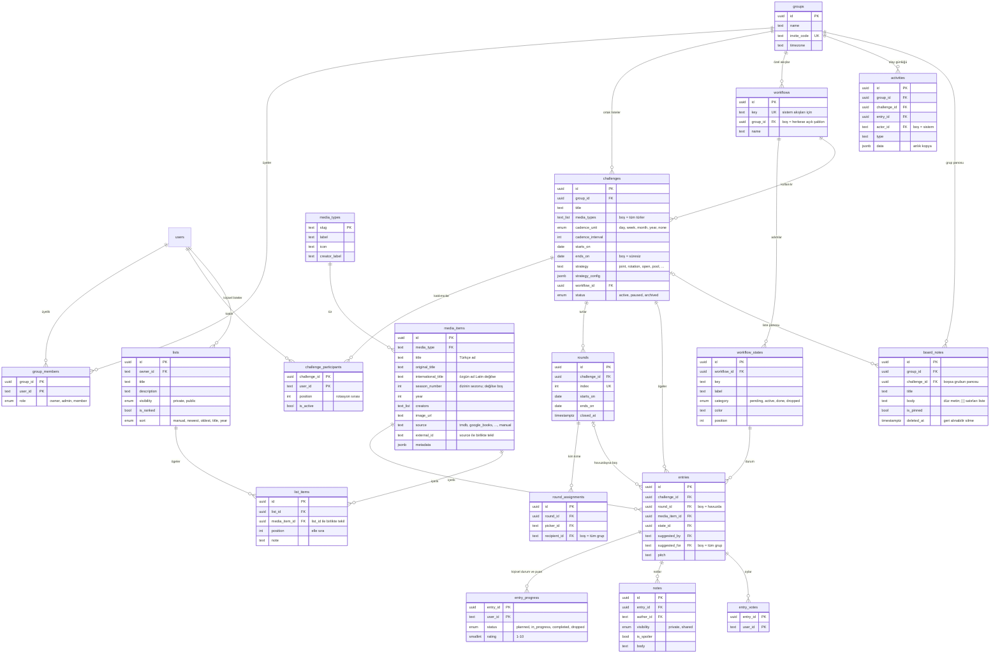

# Veri modeli

Şemanın tek gerçek kaynağı `src/db/schema/*.ts`. SQL migration'ları `drizzle/` altında ondan üretiliyor (`npm run db:generate`). 22 tablo var; 5'i Better Auth'a ait.

Adlandırma: arayüzdeki **ortak liste** kodda ve veritabanında `challenges`; **kişisel liste** `lists`.

## ER diyagramı

## Tablolar

### Kimlik (Better Auth)
`users`, `sessions`, `accounts` (şifre hash'i burada), `verifications`, `rate_limits`. Alan adları Better Auth'un beklediği şekilde; uygulama açılırken Better Auth şemayı kontrol ediyor ve eksik alan varsa açık bir hata yazıyor. Kimlikler Better Auth'un ürettiği metin ID'ler, uygulamanın kendi tabloları UUID kullanıyor.

### Gruplar
- **groups:** ad, açıklama, davet kodu (karıştırılabilecek harfler olmadan 8 karakter), saat dilimi ("bugün" ve tur sınırları buna göre).
- **group_members:** üyelik ve küçük bir rol alanı (`owner / admin / member`).

### Katalog
- **media_types:** enum değil, tablo. Yeni bir tür eklemek bir `INSERT`, elle ekleme hemen çalışıyor. Otomatik veri için ayrıca bir sağlayıcı adaptörü yazılıyor.
- **media_items:** tüm grupların paylaştığı katalog. API'den gelen öge `(source, external_id)` kısmi benzersiz index'iyle bir kez saklanıyor. Elle girilenler `source = 'manual'`. Türe özgü ayrıntılar (süre, sayfa, sezon, tür, ISBN…) `metadata` (JSONB) içinde; yeni bir bilgi eklemek migration gerektirmiyor. Üç ad var: `title` (TMDB'de Türkçe ad), `original_title` (özgün yazım, Türkçe addan farklıysa) ve `international_title` (özgün ad Latin dışı bir alfabedeyse TMDB'nin İngilizce adı: "Сталкер" için "Stalker"). Uygulama özgün adı (ya da Latin karşılığını) öne, Türkçe adı paranteze koyar. Bir dizinin sezonu ayrı bir satırdır (`season_number`, TMDB'de `tv:<id>:s<n>`), böylece "Lost · 1. Sezon" ile "2. Sezon" aynı listeye ayrı ayrı, kendi tarihleriyle girer.

### Durum akışları
- **workflows:** `group_id` boşsa herkesin kullanabildiği şablon (sistemin `default` akışı), doluysa o gruba özel akış.
- **workflow_states:** sıralı adımlar. `category` motorun anladığı tek şey; `label` ve `color` tamamen serbest.

### Ortak liste motoru
- **challenges:** davranış tamamen veriyle tanımlı: sıklık (`cadence_unit` × `cadence_interval`, `starts_on`, `ends_on`), kural (`strategy` + `strategy_config`), akış (`workflow_id`) ve izin verilen türler (`media_types`). `starts_on` geçmişte olabilir (geçmiş turlar sonradan doldurulur).
- **challenge_participants:** grup üyelerinin hepsi her listeye katılmak zorunda değil. `position` rotasyon sırası; ayrılan kişi `is_active = false` olur, geçmişi korunur.
- **rounds:** periyotlar ihtiyaç anında üretilip saklanıyor (bkz. [ARCHITECTURE.md §3.2](ARCHITECTURE.md#32-turlar-cron-yerine-tembel-üretim)). Planlama gelecek bir turu önceden oluşturabilir; turlar her zaman 0'dan boşluksuz ilerler. Süresiz listelerde `ends_on` boş ve tur elle kapatılıyor (`closed_at`).
- **round_assignments:** kuralın `planRound()` çıktısı ("Kaan → Ayşe", ya da "Ayşe → tüm grup"). Saklandığı için katılımcılar değişse de geçmiş turlar doğru kalıyor.

### Ögeler ve etkileşim
- **entries:** bir medya ögesinin bir ortak listeye girmiş hali. İş akışında ilerleyen birim bu. `round_id` boşsa havuzda bekleyen aday ya da planlı listede tura yerleşmemiş öneri. `suggested_for` boşsa öneri tüm gruba.
- **entry_progress:** kişi başına bir satır: kendi durumu, 1–10 puan (`CHECK` kısıtıyla), başlama ve bitirme zamanı.
- **notes:** `private` (sadece yazan görür) ya da `shared` (grup görür, aynı zamanda sohbet akışı); spoiler işareti.
- **entry_votes:** havuz adaylarına oy.

### Olay günlüğü
- **activities:** sadece ekleme yapılan günlük. Grup akışını ve ögenin geçmişini besliyor. `data` alanı o anki başlık, durum ve tur adlarının kopyasını tutuyor; bir şey sonradan yeniden adlandırılsa da eski kayıtlar doğru okunuyor.

### Kişisel listeler
- **lists:** bir kullanıcının listesi: ad, açıklama, görünürlük (`private` yalnızca sahibi, `public` linki olan herkes), `is_ranked` (numaralı gösterim) ve `sort` (listenin gösterildiği sıra: elle, tarihe, başlığa ya da yıla göre; sahibi seçer). Kullanıcı silinirse listeleri de silinir.
- **list_items:** listedeki ögeler. Aynı katalog ögesi bir listede bir kez bulunur; `position` elle belirlenen sıra (sürükle-bırak bütün sırayı tek sorguyla yeniden yazar), `note` ögeye düşülen kısa not, `added_at` ögenin günü (sahibi değiştirebilir; "İzlediklerim" gibi listelerde izleme günü). Katalog ortak olduğu için kişisel listedeki bir öge ortak listeye aynı satırla önerilebilir.

### Pano
- **board_notes:** bir ortak listenin (`challenge_id`) ya da grubun kendisinin (`challenge_id` boş) panosundaki notlar: isteğe bağlı başlık, düz metin gövde, sabitleme. Gövdede `[ ]` / `[x]` ile başlayan satırlar işaretlenebilir liste olarak okunur; ayrı bir satır tablosu yok, çünkü notlar elle yazılıyor ve olduğu gibi yapıştırılıyor. Silinen not `deleted_at` ile gizlenir, silen kişi 10 dakika içinde geri alabilir. `created_by` / `updated_by` kim yazdı, kim son düzenledi. Motor bu tabloyu hiç okumaz.

## Tasarım kararları

| Karar | Neden |
| --- | --- |
| Kural ayarları JSONB, şeması kodda (Zod) | Her kuralın farklı ayarları var. Yeni bir ayar ya da yeni bir kural migration gerektirmiyor; okurken doğrulanıyor ve bilinmeyen ya da hatalı değerler varsayılanlara düşüyor. |
| Durumlar satır, kategoriler enum | Kullanıcılar adım ekler veya adını değiştirir; motorun kuralları (başlangıç adımı, otomatik tamamlama, limitler) dört sabit kategoriye bakar. |
| Grup durumu ile kişisel ilerleme ayrı | "Önerildi → Kabul Edildi" grubun kararı, "Okudum, 8/10" kişinin deneyimi. Biri okurken diğeri henüz başlamamış olabilir. |
| Turlar ve atamalar saklanıyor | Hesaplanabilirdi ama o zaman katılımcı değişince geçmiş turlar "yeniden yazılırdı". Ayrıca "bu turda kim kime önermedi" gibi sorgular basitleşiyor. |
| Katalog global ve tekil | Aynı film birden çok grupta önerilebilir; veri bir kez çekilir, bir kez saklanır. |
| Silme davranışları | Grup silinirse içindeki her şey silinir (`cascade`). Kullanıcı silinirse önerileri kalır, öneren alanı boşalır (`set null`). Kullanımdaki akış ya da katalog ögesi silinemez (`restrict`). |
| Saatsiz tarih (`date`) | Tur sınırları gün bazında; saat dilimi ve yaz saati sorunları ortadan kalkıyor. |
| Kişisel listeler ayrı tablolarda | Ortak listeler gruba ait ve tur, kural, durum, puan taşıyor; kişisel listeler kişiye ait ve yalnızca sıralı bir koleksiyon. Ortak alan neredeyse olmadığı için tek tabloda birleştirmek yerine ikisi ayrı tutuldu; katalog (`media_items`) ikisini bağlıyor. |

## Senaryolar: model nasıl karşılıyor?

| Senaryo | Kurulum |
| --- | --- |
| Aralıkta seçilen, 2027'de her çeyrek bir kitap; biri sonra seçilecek | `month × 3`, `starts_on = 2027-01-01`, `ends_on = 2027-12-31` + Birlikte belirliyoruz (tur başına 1). Üç çeyrek dolar, dördüncüsü boş kalır |
| Ay sonunda birlikte seçilen yönetmen ve filmi; bazen üç ay birden | `month × 1` + Birlikte belirliyoruz. Gelecek aylar önceden doldurulur |
| 2025'ten beri okuduklarımızı da girelim | `starts_on = 2025-01-01` + Birlikte belirliyoruz; geçmiş turlara "Hepimiz bitirdik" diye eklenenler "Tamamlandı" olur |
| İki kişi her hafta birbirine film öneriyor | `week × 1` + Sırayla öneri (karşılıklı) |
| Aylık kitap kulübü, her ay sıradaki kişi kitabı seçiyor | `month × 1` + Sırayla öneri (tek seçici) |
| Film gecesi: herkes aday ekler, oylamayla seçilir | Süresiz + Ortak havuz (oy). Her film gecesi "Sonraki tura geç" |
| Çeyreklik klasikler, havuzdan kurayla | `month × 3` + Ortak havuz (kura, otomatik seçim) |
| Ortak izleme listesi | Süresiz + Serbest öneri (limitsiz, gruba, onaysız) |
| Kişisel izleme listesi, yıl sonu Top 10 | Listelerim → yeni liste (sıralı ya da sırasız), gizli ya da herkese açık |
| Aralarından her ay birini seçtiğimiz 40 yönetmen | Ortak listenin panosunda bir not; Keep'ten yapıştırılır, "Liste yap" ile işaretlenebilir olur, kullanılan yönetmen işaretlenir |
| Birlikte izleyeceğimiz diziler | Süresiz + Ortak havuz (elle ya da oyla seçim); her dizi bitince "Sonraki tura geç". Yalnızca not olarak tutmak için grup panosu |
| Üçüncü arkadaş katıldı | Davetle gruba girer, liste sayfasında "Listeye katıl"; bir sonraki turdan itibaren rotasyonda |
| Aynı kişilerle ayrı bir grup (ör. iş arkadaşları) | Yeni grup; kişi birden fazla grupta olabilir |
| "Okunuyor" ya da "Ertelendi" adımı | Grup sayfası → Durum akışları → Yeni akış |
| Çizgi roman türü | `INSERT INTO media_types (slug, label, icon, creator_label, sort_order) VALUES ('comic', 'Çizgi roman', '🦸', 'Yazar', 7);` |
| Oyunlar için otomatik veri (RAWG/IGDB) | Yeni bir `MediaProvider` dosyası; şema değişmez |
