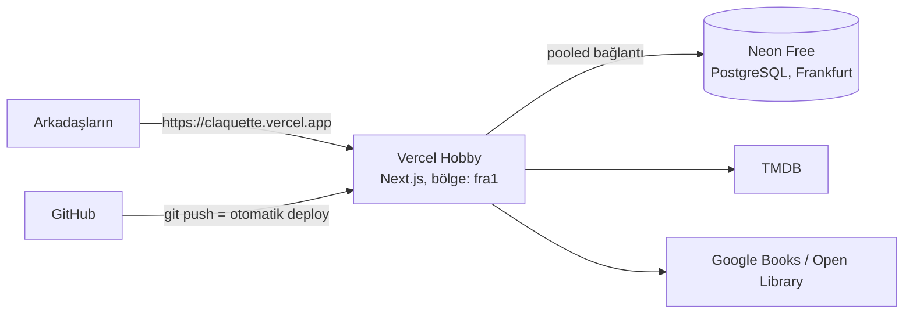

# Ücretsiz canlıya alma (Vercel + Neon)

Hedef: kredi kartı vermeden, sıfır maliyetle yayında bir uygulama.



| Parça | Servis | Ücretsiz katman (yaklaşık, güncelini sitesinden kontrol et) |
| --- | --- | --- |
| Uygulama | [Vercel Hobby](https://vercel.com/pricing) | Kişisel / ticari olmayan kullanım için. Aylık ~100 GB veri transferi, ~1M fonksiyon çağrısı, ~4 saat aktif CPU. Limit aşılırsa ücret kesilmez, kullanım durdurulur. |
| Veritabanı | [Neon Free](https://neon.com/pricing) | Proje başına 0,5 GB depolama ve ~100 CU-saat/ay. En küçük boyutta (0,25 CU) bu yaklaşık 400 saat aktif süre demek. 5 dakika boşta kalınca uyur, ilk istekte saniyenin altında uyanır. |
| Film/dizi verisi | [TMDB API](https://developer.themoviedb.org/docs/getting-started) | Ticari olmayan kullanım ücretsiz, atıf zorunlu (uygulamanın alt bilgisinde var). |
| Kitap verisi | Google Books API, Open Library | Google: ücretsiz günlük kota (anahtar önerilir). Open Library anahtarsız. |
| Kaynak kod | GitHub | Ücretsiz özel (private) repo. |

Birkaç kişilik bir grup bu limitlerin çok altında kalır: binlerce öge birkaç MB tutar.

---

## 1. Kodu GitHub'a gönder

```bash
git init
git add .
git commit -m "Claquette: ilk sürüm"
# GitHub'da boş bir (tercihen private) repo oluştur, sonra:
git remote add origin https://github.com/<kullanici>/claquette.git
git branch -M main
git push -u origin main
```

`.env.local` `.gitignore`'da; gizli anahtarlar repoya girmez.

## 2. Neon'da veritabanı oluştur

1. [neon.com](https://neon.com)'a GitHub hesabınla kaydol.
2. **Create project**: ad `claquette`, bölge **AWS Europe Central 1 (Frankfurt)**. Türkiye'ye ve Vercel'in `fra1` bölgesine en yakın seçenek; `vercel.json` uygulamayı zaten `fra1`'de çalıştırıyor.
3. Proje panelinde **Connect**:
   - **Connection pooling açık** iken görünen adres (host'unda `-pooler` geçer) → `DATABASE_URL`
   - **Connection pooling kapalı** iken görünen adres → `DATABASE_URL_UNPOOLED` (migration'lar için; isteğe bağlı ama önerilir)
4. *(Lokal geliştirme için önerilir)* **Branches → Create branch** ile `main`'den bir `dev` branch'i aç; onun adresini lokal `.env.local` dosyana yaz. Böylece lokal denemelerin canlı veriye dokunmaz.

> Alternatif: Vercel projesinde **Storage → Neon** entegrasyonu da veritabanını açıp `DATABASE_URL` ve `DATABASE_URL_UNPOOLED` değişkenlerini kendisi ekler. Her preview deploy için ayrı bir veritabanı branch'i de açabilir; bu durumda Preview ortamına `MIGRATE_ON_PREVIEW=1` ekle.

## 3. API anahtarlarını al

**TMDB (film ve dizi):**
1. [themoviedb.org](https://www.themoviedb.org) hesabı aç → **Settings → API** → geliştirici anahtarı başvurusu (kullanım tipi: kişisel). Uygulama adresi olarak ileride alacağın Vercel adresini yazabilirsin.
2. **API Read Access Token**'ı (uzun, `eyJ…` ile başlayan) ya da **API Key**'i kopyala → `TMDB_API_KEY`. Uygulama ikisini de tanır.

**Google Books (kitap, isteğe bağlı ama önerilir):**
1. [console.cloud.google.com](https://console.cloud.google.com) → yeni proje.
2. **APIs & Services → Library → Books API → Enable**.
3. **Credentials → Create credentials → API key**. Güvenlik için anahtarı **API restrictions → Books API** ile sınırla → `GOOGLE_BOOKS_API_KEY`.

Anahtarsız da çalışır, ancak Google anahtarsız istekleri IP başına paylaşımlı kotayla sınırlıyor ve Vercel'in IP'leri paylaşımlı olduğu için sık sık `429` dönebilir. O durumda uygulama Open Library sonuçlarını göstermeye devam eder.

## 4. Gizli değerleri üret

```bash
# BETTER_AUTH_SECRET
node -e "console.log(require('crypto').randomBytes(32).toString('base64'))"
```

`REGISTRATION_CODE` için arkadaşlarına söyleyeceğin bir kod seç (ör. `film-gecesi-2026`). Uygulama herkese açık bir adreste olacağı için boş bırakmaman önerilir.

## 5. Vercel'e deploy et

1. [vercel.com](https://vercel.com)'a GitHub ile kaydol (Hobby).
2. **Add New → Project → `claquette` reposunu Import et.** Framework olarak Next.js otomatik seçilir. Build komutu `vercel.json`'dan gelir (`npm run vercel-build`): önce migration'ları uygular, sonra derler.
3. **Environment Variables** (Production ve Preview için):

   | Değişken | Değer |
   | --- | --- |
   | `DATABASE_URL` | Neon pooled adresi |
   | `DATABASE_URL_UNPOOLED` | Neon doğrudan adres (önerilir) |
   | `BETTER_AUTH_SECRET` | 4. adımda üretilen değer |
   | `REGISTRATION_CODE` | seçtiğin kayıt kodu |
   | `TMDB_API_KEY` | TMDB anahtarı/token'ı |
   | `GOOGLE_BOOKS_API_KEY` | Google anahtarı |
   | `BETTER_AUTH_URL` | *Boş bırakılabilir.* Uygulama Vercel'in üretim adresini kendisi bulur. Kendi alan adını bağlarsan `https://alanadin.com` yaz; paylaşılan listelerin link önizlemeleri de bu adresi kullanır. |

4. **Deploy.** Build günlüğünde `[migrate] Database is up to date.` satırını görmelisin. Bu satır tabloları ve başlangıç verisini (medya türleri, varsayılan durum akışı) oluşturur.
5. Verilen adresi aç (ör. `https://claquette-xxxx.vercel.app`) → **Kayıt ol** (kayıt koduyla) → grup oluştur → **Bağlantıyı kopyala** ile davet linkini arkadaşına gönder.

> Migration'ları lokalden de çalıştırabilirsin: `.env.local`'a Neon adresini koyup `npm run db:migrate`.

## 6. Sonraki güncellemeler

- **Kod değişikliği:** `git push`; Vercel otomatik derleyip yayınlar. Başka branch'lere push edince ayrı bir *preview* adresi oluşur.
- **Şema değişikliği:** `src/db/schema` düzenle → `npm run db:generate` → oluşan `drizzle/*.sql` dosyalarını commit'le → push. Production derlemesi migration'ı uygular.
- **Preview ve migration:** Preview deploy'lar varsayılan olarak migration **çalıştırmaz** (genelde production veritabanını paylaşırlar; birleştirilmemiş bir branch'in şemayı değiştirmesini istemeyiz). Preview'lara ayrı Neon branch'i veriyorsan `MIGRATE_ON_PREVIEW=1` ile açabilirsin.
- **Kendi alan adı:** Vercel → Project → **Settings → Domains**. Sonra `BETTER_AUTH_URL`'ı yeni adrese ayarla ve yeniden deploy et.

## Alternatif: Supabase

Uygulama yalnızca PostgreSQL kullanıyor; Supabase'in Auth veya Storage özelliklerine ihtiyacı yok.

1. [supabase.com](https://supabase.com) → **New project**, bölge **Frankfurt (eu-central-1)**, veritabanı şifresini kaydet.
2. **Connect** penceresinden:
   - **Transaction pooler** (port `6543`) → `DATABASE_URL`. Uygulama `prepare: false` ile bağlandığı için bu modla uyumlu.
   - **Session pooler** (port `5432`) → `DATABASE_URL_UNPOOLED` (migration'lar için. Doğrudan bağlantı yalnızca IPv6 olabildiğinden session pooler daha güvenli bir seçim.)
3. Gerisi Neon ile aynı.

**Dikkat:** Supabase'in ücretsiz [planında](https://supabase.com/pricing) bir hafta boyunca hiç istek gelmeyen proje duraklatılır (veri silinmez, panelden **Restore** ile açılır). Aylık ya da çeyreklik listelerde bu sık yaşanabilir; Neon'un önerilmesinin ana sebebi bu.

## Sorun giderme

| Belirti | Çözüm |
| --- | --- |
| Girişte "Invalid origin" ya da 403 | `BETTER_AUTH_URL` tarayıcıdaki adresle birebir aynı olmalı (`https://` dahil). Vercel'de boş bırakmak genelde en kolayı. |
| Build `[migrate] Migration failed` ile duruyor | `DATABASE_URL` / `DATABASE_URL_UNPOOLED` değerlerini kontrol et; adresin doğru projeye ve branch'e ait olduğunu, şifrenin doğru kopyalandığını doğrula. Hata mesajının devamı asıl sebebi söyler. |
| `encoding "WIN1252"` hatası (lokal) | Veritabanı UTF8 değil. `CREATE DATABASE claquette ENCODING 'UTF8' TEMPLATE template0;` |
| Film/dizi araması görünmüyor | `TMDB_API_KEY` tanımlı değil. Elle ekleme çalışmaya devam eder. |
| "Google Books şu an yanıt vermiyor" | Anahtarsız kota doldu. `GOOGLE_BOOKS_API_KEY` ekle. |
| Supabase'de bağlantı zaman aşımı | Proje duraklatılmış olabilir; panelden Restore. |

## Yedekleme

Neon'un ücretsiz planında geri dönüş penceresi kısa. Ara sıra yedek almak iyi bir alışkanlık:

```bash
pg_dump "$DATABASE_URL_UNPOOLED" --no-owner --format=custom --file=claquette-$(date +%F).dump
```
